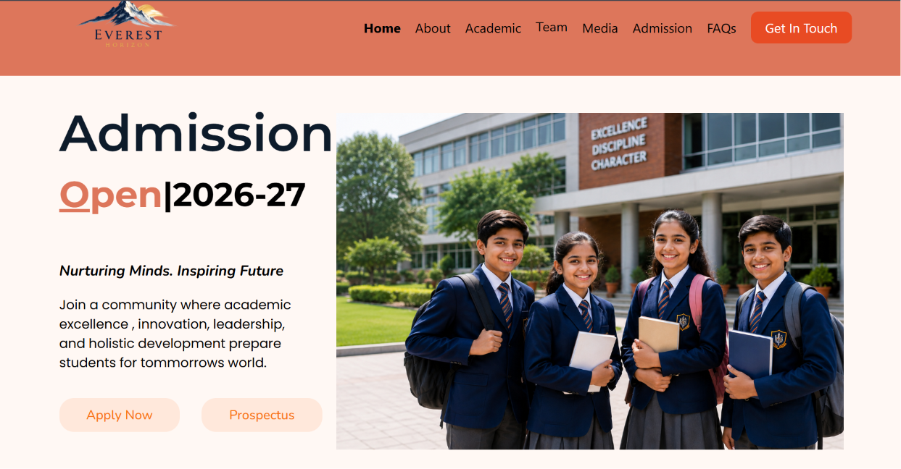

# School-Site

## Introduction
A modern school website that I built to present school information, announce future events and academic programs and provide essential contact details for students, parents, and staff.

## Description
 School site is a clean and modern look site that mainly focused on the education and to showcase the features and the facilities provided by the school. This site include all the necessary sections for the complete information and interaction between school commitee and students, parents or visitors. 
## Features
- Attractive responsive navbar
- Linked section
- Responsive for almost every screen
## Website Overview
### Home page

### Admission Page

## Why i created this site
 project goal: I want to improve myself on using html, css and js language and make a new project for my self knowledge. Also i am so amazed how various features work , how are they created. Time duration: It take about 26 to 27 hours. i was so locked in while i was making this project. thats why i forgot to commit for a while. Sorry for my fault , i will ensure not to repeat this mistake in further days:( :( :( :( :( :( :(
## Getting Started
### Dependencies
No external libraries or frameworks are required
- A modern web browser (Edge)
- A code editor such as Visual Studio Code (recommended).
- A operating system (Window 11 pro )
- HTML5, CSS3, JavaScript support.
### Installing
- Clone this repository or download the zip file
git clone https://github.com/prateekadk26-prog/School-Site
- Navigate to the project folder.
cd portfolio
- Open the project folder in VS code
code .
- Make sure all project files and folders are in their correct locations.

### Executing Program
- Open the project folder in VS code.
- Locate index.html.
- Right click on index.html.
- Select Open with Live Server (if the Live Server extension is installed).
Alternatively, simply double-click index.html to open the website in your browser.
## License
This project is licensed under MIT License - see the [LICENSE](LICENSE)

## Tech Stack
- HTML5
- CSS3 
- JavaScript
## Author 
Prateek Adhikari
## Demo Link
[Demo Link](https://prateekadk26-prog.github.io/School-Site/)
